# Galerie des exemples

Chaque script de ce dossier construit une carte de champ avec `fieldlines`, l'affiche
et l'enregistre en PDF à côté de lui ; les images ci-dessous en sont la version PNG,
dans l'ordre où on peut les lire : charges, fils chargés, dipôles, départs selon le
flux, champ uniforme, puis le champ magnétique.

## Électrostatique

### Deux charges différentes — `deux_charges.py`

Deux charges +2 et −1 : le flux de la charge négative vaut la moitié de celui de la
positive, donc une ligne sur deux parties de +2 aboutit sur −1 et les autres filent à
l'infini. `lignes_selon_flux` place les départs en nombre proportionnel à la charge et
n'ajoute autour de −1 aucune ligne déjà arrivée depuis +2 ; les équipotentielles
viennent de `niveaux(20, echelle="log", symetrique=True)` et de
`trace_equipotentielles`, les charges de `trace_sources` (aire proportionnelle à |q|).

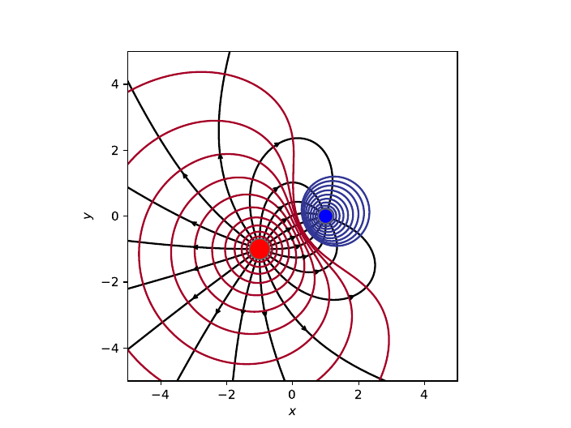

### Deux charges positives et deux négatives — `quatre_charges.py`

Deux charges +1 en bas et deux charges −1 en haut, aux sommets d'un carré : chaque
ligne va d'une charge positive à l'une des négatives, et le potentiel s'annule sur
l'axe Ox, qui sépare les équipotentielles rouges des bleues. Tout est automatique :
`lignes_autour(nombre=10, rayon=0.2)` fait partir dix lignes à angles réguliers autour
de chaque charge, puis `trace_lignes`, `trace_fleches`, `trace_equipotentielles` et
`trace_sources` dessinent la carte.

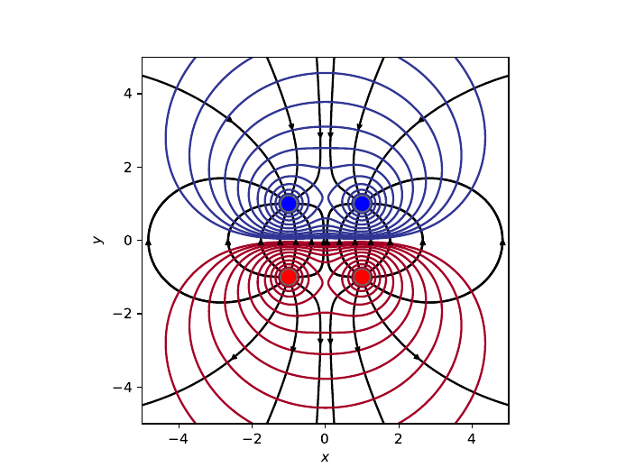

### Quatre charges égales et points de champ nul — `quatre_charges_egales.py`

Quatre charges égales aux sommets d'un carré : le champ s'annule au centre et en quatre
points des axes, marqués en bleu, dont la position sur Ox est résolue par
`scipy.optimize.brentq`. Les lignes de `lignes_autour` s'arrêtent d'elles-mêmes au
point d'arrêt central ; `niveaux(10, echelle="log", vmin=0.5, vmax=5, ajoute=[...])`
donne des niveaux logarithmiques entre deux bornes, plus trois niveaux ajoutés dont
celui qui passe par les quatre points de champ nul des axes, où l'équipotentielle se
croise elle-même.

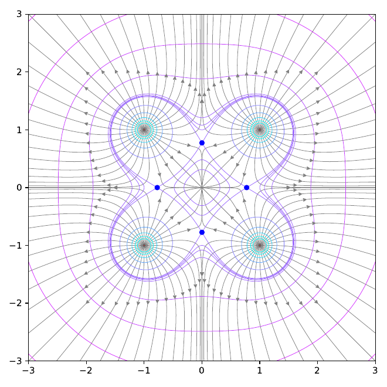

### N charges sur un cercle — `charges_sur_un_cercle.py`

N charges égales régulièrement réparties sur un cercle, pour N = 3, 5, 6, 7, 8 et 15.
Plus N grandit, plus la distribution ressemble à un anneau uniformément chargé : les
équipotentielles extérieures s'arrondissent et le champ à l'intérieur s'affaiblit (il
s'annule au centre, où les lignes s'arrêtent). Une `Carte` par panneau, avec
`lignes_autour` et un nombre de lignes par charge qui décroît avec N, puis
`niveaux(10, echelle="log", vmin=1, vmax=10)` et `trace_equipotentielles` à faible
`contraste`.

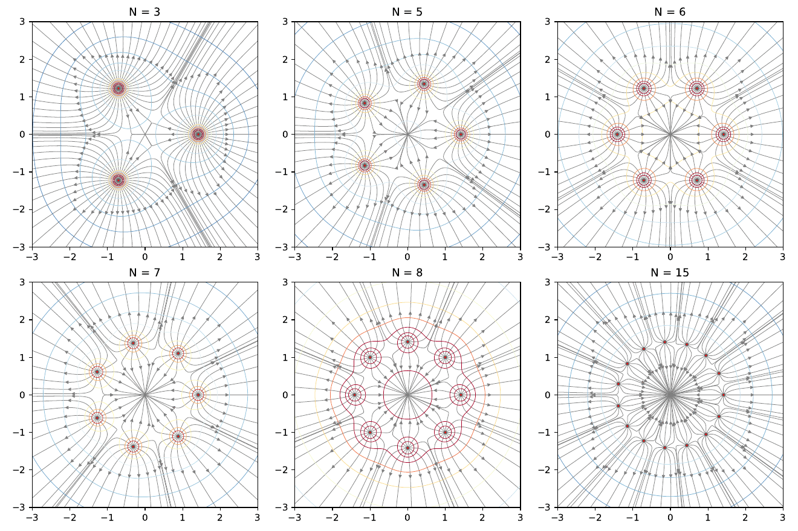

### Six fils chargés — `fils_charges.py`

Six fils rectilignes infinis, perpendiculaires à la figure, de charges linéiques
alternées ±1/2 aux sommets d'un hexagone : un problème plan, où le champ d'un fil
décroît en 1/r et le potentiel est logarithmique. `FilCharge` remplace `Charge`,
`lignes_autour(nombre=48, rayon=0.2)` fait partir 48 lignes de chaque fil ; les
équipotentielles prennent des niveaux linéaires, auxquels `niveaux(20, ajoute=[-0.1,
0.1, 0])` ajoute trois valeurs dont le niveau zéro, avec la palette `plasma_r`.

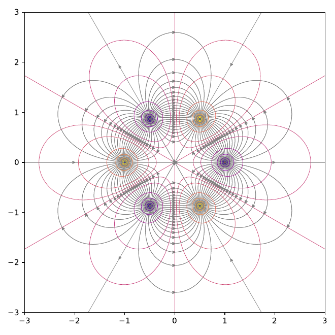

### Deux charges et un dipôle, toutes les retouches — `charges_et_dipole.py`

Une paire de charges ±1 et, à côté, un dipôle ponctuel de moment vertical, dans un
cadre large qui montre à la fois les lignes qui joignent les charges et celles qui
filent à l'infini. Le script passe en revue les retouches : `lignes_autour` numérote
les lignes source après source, `ajoute_ligne` en pose une à la main avec trois
flèches et une grande `marge`, `ajuste` change la marge et les flèches d'une ligne
désignée par son numéro, `retire` en enlève plusieurs d'un coup. `trace_noms` écrit les
numéros sur la figure, et `ax.clabel` les valeurs du potentiel sur les
équipotentielles, confinées près des sources à cette échelle.

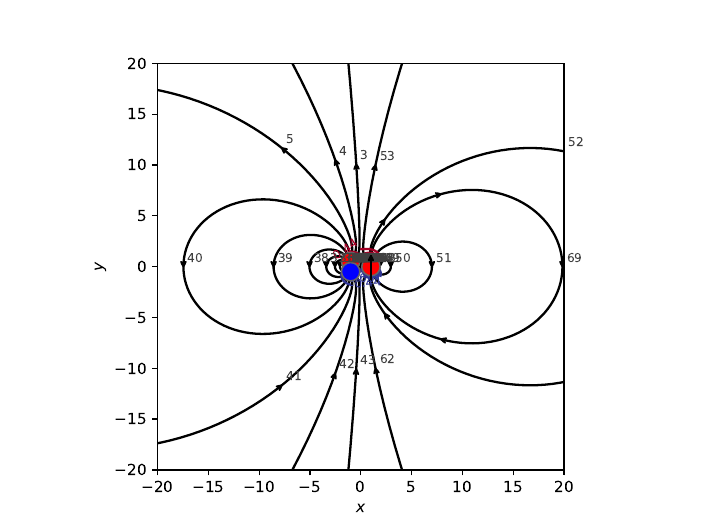

### Quadrupôle — `quadrupole.py`

Quatre charges ±1 alternées aux sommets d'un carré, un quadrupôle : les lignes vont de
chaque charge positive à ses deux voisines négatives, et le potentiel s'annule sur les
diagonales. À gauche, `lignes_autour` trace deux fois chaque ligne qui joint deux
charges, une fois depuis chaque bout ; `ajuste` déplace des flèches et `retire`
supprime les doublons, désignés par les numéros que `trace_noms` permet de lire. À
droite, `lignes_selon_flux` obtient le même résultat sans retouche.

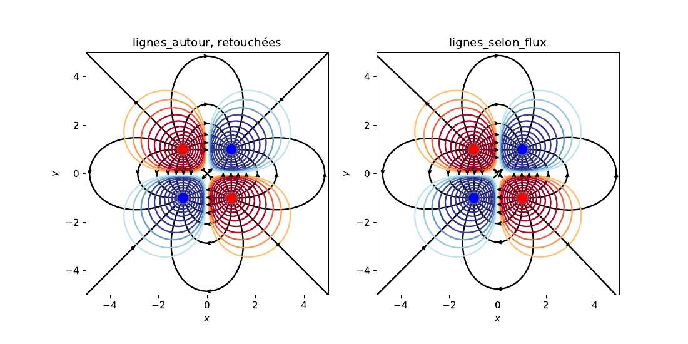

### Approximation dipolaire — `approximation_dipolaire.py`

Deux charges ±1 distantes de 1 et, superposé, le dipôle ponctuel de même moment : loin
des charges, les équipotentielles des deux cartes (traits pleins pour la paire, tirets
pour le dipôle) se confondent ; près d'elles, elles s'écartent. Les niveaux viennent
de `niveaux(20, echelle="log", symetrique=True)` sur la paire, et la seconde carte
réutilise le `norm` du `QuadContourSet` rendu par `trace_equipotentielles`, pour que
les mêmes valeurs aient les mêmes couleurs.

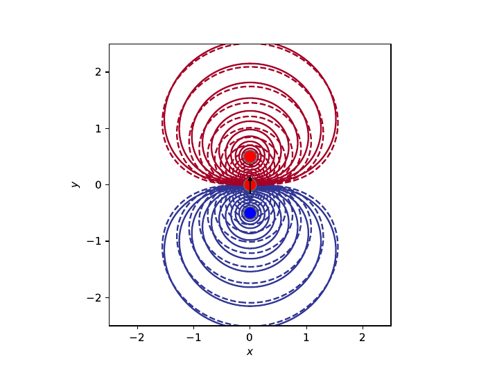

## Départs selon le flux

### Placer les lignes selon le flux — `selon_le_flux.py`

La densité des lignes doit refléter l'intensité du champ. `lignes_autour` (à gauche)
fait partir autant de lignes de chaque charge quelle que soit sa valeur, et trace deux
fois chaque ligne qui joint deux charges ; `lignes_selon_flux` (à droite) donne à
chaque charge un nombre de lignes proportionnel à sa charge et n'ajoute autour des
charges négatives que les lignes qui leur manquent. En haut, deux charges +3 et −1 ;
en bas, trois fils chargés (problème plan), où la densité des lignes suit exactement
l'intensité du champ. Les titres comptent les lignes de chaque carte avec
`len(carte)` ; `trace` dessine lignes, flèches et sources d'un coup.

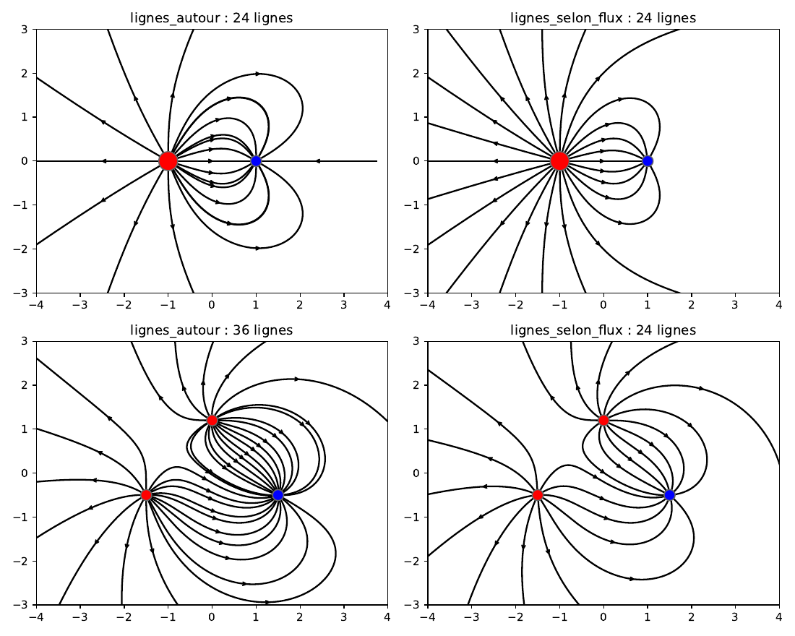

## Champ uniforme

### Une charge dans un champ uniforme — `champ_uniforme.py`

`ChampUniforme(E=(1, 0))` s'ajoute à une charge comme une source ordinaire. Les lignes
issues de la charge (`lignes_autour`) s'échappent vers les x positifs ; celles du champ
uniforme, parties du bord gauche avec `lignes_le_long(..., repartition="flux_revolution")`
(Ox est un axe de révolution), contournent la charge. La séparatrice passe par le
point de champ nul en (−1, 0), où q/r² = E₀, marqué sur la figure ; les
équipotentielles de V = −x + 1/r viennent de `niveaux(13, vmin=-3, vmax=3)` et d'un
`Normalize` explicite.

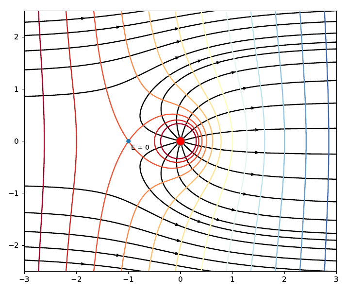

## Magnétostatique

### Fils de courant — `fils_courants.py`

Fils rectilignes infinis perpendiculaires à la figure. À gauche, deux fils parcourus en
sens opposés (⊙ et ⊗) : les lignes sont des cercles qui entourent chaque fil, de plus
en plus décentrés à mesure qu'ils grandissent, et la médiatrice. À droite, deux nappes
de six fils de sens opposés : le champ est presque uniforme entre elles, comme dans un
solénoïde coupé en deux. Les lignes du champ magnétique sont fermées : `lignes_le_long`
les fait partir d'un segment qu'elles coupent toutes, à flux égal du champ dans la
figure, et chacune s'arrête quand elle se referme.

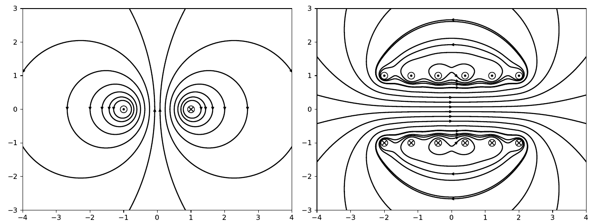

### Spire circulaire — `spire.py`

Une spire vue par la tranche (plan méridien), qui perce la figure en ⊙ et ⊗. À gauche,
les lignes intégrées pas à pas, parties du diamètre de la spire avec `lignes_le_long`
à flux égal du champ de la figure ; chacune s'arrête quand elle se referme. À droite,
les mêmes lignes obtenues autrement : ce sont les lignes de niveau de la fonction de
flux Ψ = ρ A_φ, exacte par les intégrales elliptiques, que `trace_lignes_de_flux`
dessine à niveaux équidistants, des tubes de même flux dans l'espace, donc plus
espacés près de l'axe.

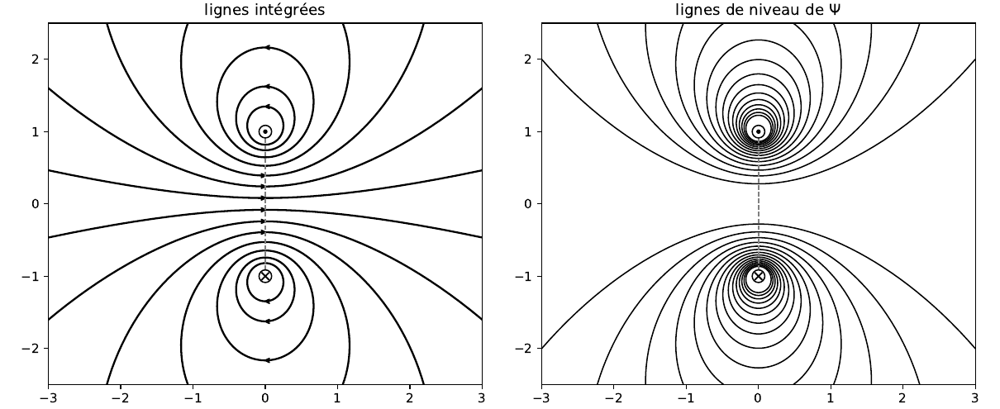

### Bobines de Helmholtz — `bobines_de_helmholtz.py`

Deux spires coaxiales de même rayon R, distantes de R : le champ est presque uniforme
entre elles, d'où les lignes parallèles au centre. Les deux sources ont le même axe,
donc la fonction de flux existe et `lignes_le_long(..., repartition="flux_revolution")`
répartit les départs du plan médian à flux égal dans l'espace ; `trace` dessine
lignes, flèches et spires.

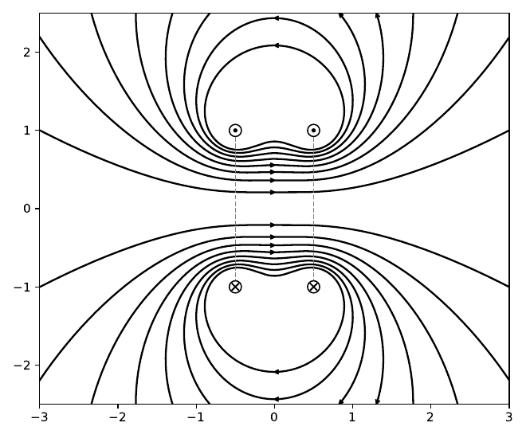

### Solénoïde — `solenoide.py`

Un solénoïde de 20 spires, de longueur 4 et de rayon 1, vu en coupe : à l'intérieur le
champ est presque uniforme, les lignes sortent par les extrémités et se referment à
l'extérieur, où le champ est faible. `Solenoide` somme les spires ; `lignes_le_long`
fait partir les lignes du plan médian, à l'intérieur, à flux égal du champ de la
figure.

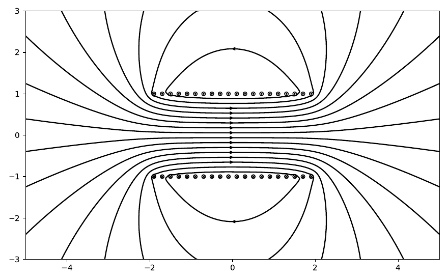

### Aimant droit — `aimant.py`

Un cylindre uniformément aimanté équivaut à un solénoïde de même forme : les lignes le
traversent du pôle sud au pôle nord, sortent par la face nord et se referment dehors.
À gauche, `Aimant` dessiné avec ses pôles, lignes parties du plan médian à flux égal
dans l'espace (`flux_revolution`) : les tubes de flux sont les mêmes dedans et dehors.
À droite, le même aimant vu de loin et, en tirets rouges, les lignes d'un
`DipoleMagnetique` de même moment, posées avec `ajoute_ligne` là où celles de l'aimant
recoupent le plan équatorial : au-delà de quelques fois sa taille, l'aimant est un
dipôle.

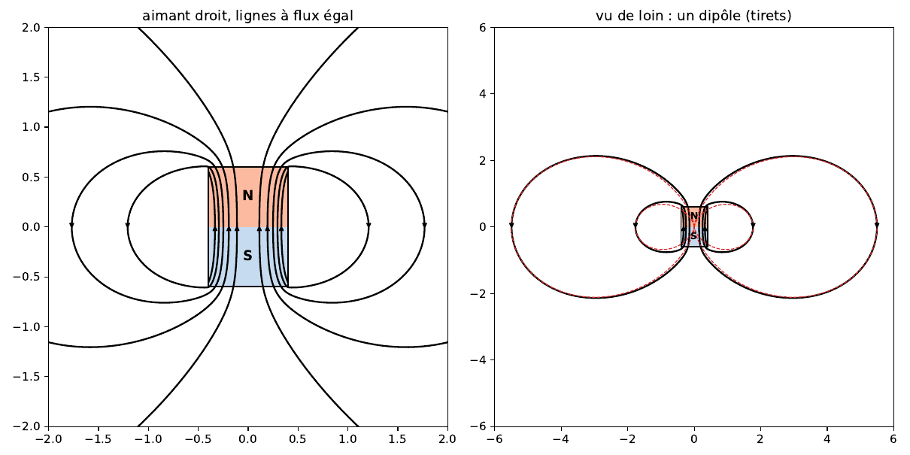

### Dipôle magnétique et petite spire — `dipole_magnetique.py`

Un dipôle magnétique ponctuel (en noir) et une petite spire de même moment (en bleu),
vus dans un plan méridien. Loin des sources, les lignes se superposent ; près d'elles,
celles de la spire entourent ses deux passages dans la figure, celles du dipôle
reviennent toutes en son centre. Les deux cartes ont les mêmes départs,
`lignes_le_long(..., repartition="reguliere")` sur l'équateur, avec un `style` de
couleur par carte ; à flux égal, ils se serreraient tous près des sources, où le champ
en 1/r³ est intense.

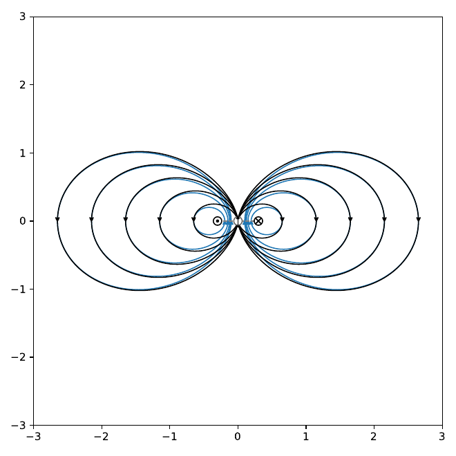
